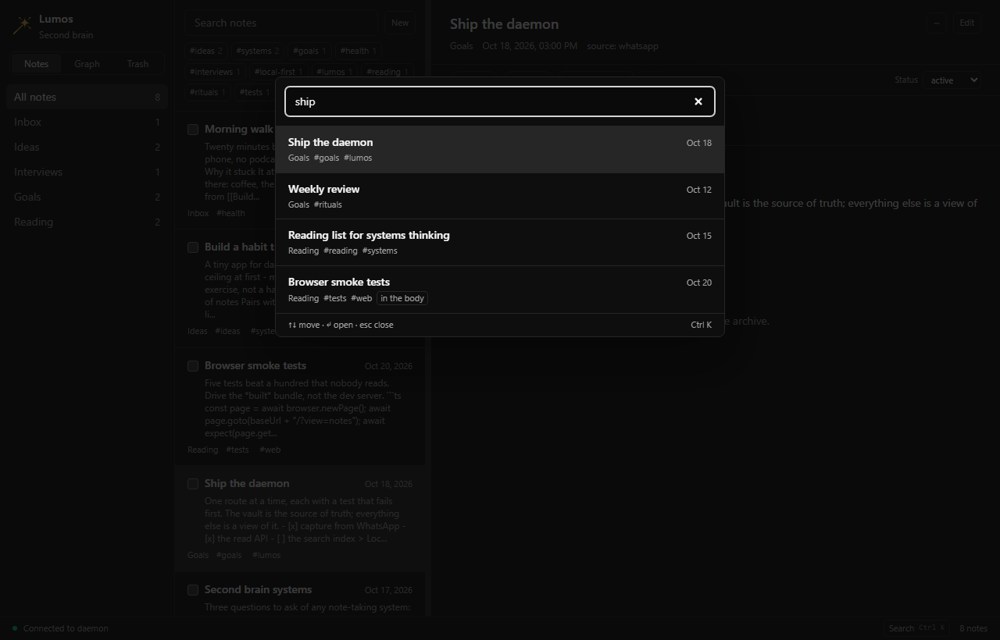
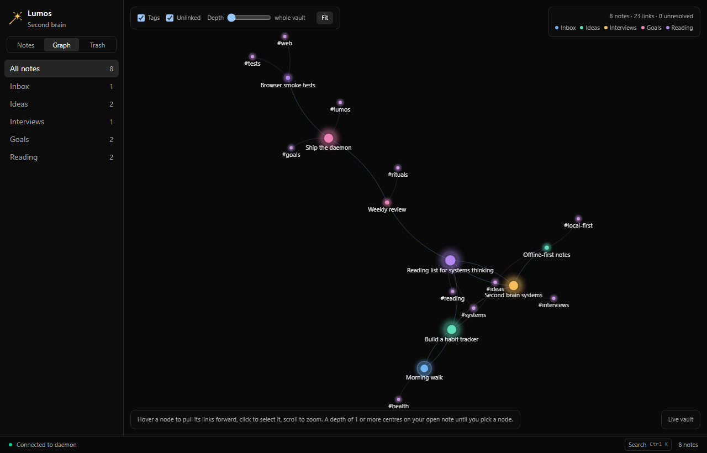

# Using Lumos

A guide to day-to-day use: capture a note from WhatsApp, browse and edit the vault in the desktop
app, and find things again. For installation and the enforced development standard see
[README.md](README.md); for what each piece is built out of see [docs/](docs).

Lumos is local-first. Notes are Markdown files in a vault folder on your own disk, the daemon reads
and writes them over `127.0.0.1`, and nothing is uploaded anywhere.

## The pieces

| Piece | What it does | Started with |
|---|---|---|
| **Daemon** | Connects to WhatsApp, parses what you send, writes the note files, and serves the HTTP API the desktop reads | `pnpm --filter daemon dev` |
| **Desktop** | The app: folder sidebar, note list, viewer and editor, search palette, link graph, trash | `pnpm --filter desktop tauri dev` (the window) or `pnpm --filter desktop dev` (in a browser at `http://localhost:1420`) |
| **MCP server** | Puts the same vault in front of Claude Code and other agents: twelve tools over stdio, no port | `pnpm --filter mcp start`, or the `claude mcp add` line in [Letting a coding agent read the vault](#letting-a-coding-agent-read-the-vault) |

The desktop works with the daemon stopped - it falls back to demo notes and says so in the status
bar - so you can look around before wiring up WhatsApp.

## Capture from WhatsApp

Message the Lumos number from an allowlisted phone. A message that starts with a command picks its
folder; anything else goes to `Inbox`.

| Command | Where it lands | Notes |
|---|---|---|
| `/idea <text>` | `vault/Ideas/` | |
| `/interview <link or text>` | `vault/Interviews/` | A link is fetched for its title, description and readable text |
| `/goal <text>` | `vault/Goals/` | |
| `/read <link>` | `vault/Reading/` | Same fetch as `/interview` |
| `/plan today` / `/plan tomorrow` | no file | Replies with up to five points from your 20 newest notes, through the Ollama model on your machine |
| `/find <query>` | no file | Replies with the title and folder of up to five matches, and counts the rest |
| `/<folder> <text or link>` | that folder | Any folder you have, by its own name: `/movies` files into `Movies`, `/to-read` into `To Read` |
| `/newfolder <name>` | no file | Makes the folder and answers the command that now files into it |
| `/` | no file | The menu: one line per folder, plus the commands above |
| `/help` | no file | Prints the same command list |
| plain text | `vault/Inbox/` | |

**Folders.** A folder is a directory in the vault, so there is no list to add to: `/newfolder
Movies` makes one, and from the next message `/movies https://example.com/trailer` files into it -
the URL goes into the note's frontmatter and the title falls back to the site name. Names answer
lower-cased with spaces as dashes, so a `To Read` folder is `/to-read`. The four shorthands above
(`/idea`, `/interview`, `/goal`, `/read`) are kept for the folders they were written for, and your
own folder wins if a name ever collides.

**Finding the commands.** WhatsApp cannot suggest a command while you type in a chat, so send `/` on
its own: the reply is the menu, built from the folders your vault has, so a folder you made a minute
ago is already in it. That is the whole trick - one keystroke instead of a cheat sheet.

What happens to what you send:

- **The first line becomes the title** and the filename: `2026-10-25-build-a-habit-tracker.md`.
- **`#hashtags` become tags** in the frontmatter, lower-cased and de-duplicated. They are the same
  tags the tag filter and the graph use, so the file and the app cannot disagree.
- **The note is stamped** with `source: whatsapp`, `created` (ISO-8601), `tags`, and `status: new`.
- **A second note with the same title gets its own file.** Nothing is ever overwritten.

`/plan` needs [Ollama](https://ollama.com/) running with the model pulled (`ollama pull llama3.2:3b`).
If it is stopped, slow, or the model is missing, the reply says which of those it was - it never
invents a plan.

## The vault

```
vault/
  Inbox/  Ideas/  Interviews/  Goals/  Reading/   # the five a new vault starts with
  Movies/  To Read/                               # and any others you make
  .trash/                                         # what a delete keeps, until you empty it
```

`.`-folders are the app's own and are never listed or read as notes.

Every note is a Markdown file with a YAML frontmatter block:

```markdown
---
source: whatsapp
created: 2026-10-25T09:12:04.339Z
tags: [ideas]
status: new
---

# Build a habit tracker

Build a habit tracker
```

`status` moves through `new`, `active`, `done` and `archived`; the desktop edits it, and the bulk
bar's **Archive** sets it to `archived`. The vault is a plain folder, so a hand edit or another
editor is fine - the app re-reads the listing after every write it makes. A note whose frontmatter
does not parse is still listed and readable; the viewer says what is wrong with the block instead of
hiding the note. Pointing Obsidian at the vault is the intended way to browse it outside the app.

## The desktop app


### Finding a note

- **Folders** in the sidebar, with a count per folder; **All** is the whole vault. The list is the
  vault's own directories, so a folder made on WhatsApp is here on the next read - and **+ New
  folder** at the bottom of the sidebar makes one from the app (the name is checked and a duplicate
  is refused with the reason).
- **Search over the list** narrows the current folder as you type.
- **Tag chips** above the list show the tags in what you are looking at, with counts. Pick one to
  narrow; pick it again to clear. A tag on a note row does the same thing.
- **`Cmd/Ctrl+K`** opens the palette from anywhere, even while a field has focus: fuzzy ranking over
  titles, tags and previews, plus a body search from the daemon for words that appear nowhere in the
  preview - those rows are marked *in
  the body*, as the last row is here. Arrow keys move, `Enter` opens, `Esc` closes. Empty, it lists
  the notes you opened this session and then six commands: **New note**, **New folder**, **Open the
  graph**, **Open the stats**, **Open the trash** and **Open the profile**. Typing puts whichever command's words match first, so `new folder` +
  `Enter` turns the field into a name field - `Enter` makes the folder and the list looks at it.
- **Moon/Sun toggle** switches the full app between dark and light palettes; the choice is saved on
  this machine.

  
- **`j` / `k`** move down and up the list without leaving the viewer.

### Reading

The viewer renders Markdown: headings, lists, tables, blockquotes, task lists, links, and fenced
code with syntax highlighting for a fence that names its language. A YouTube, Vimeo, Instagram or
Facebook link plays or embeds in place; an image link renders as the image; any other link gets a
reader with the page's text.

**Backlinks** under the note list the notes that link to this one (`[[like this]]`), and each is a
button.

### Writing

- **New** opens a composer in the list's pane - folder picker and text, `Cmd/Ctrl+Enter` to file it.
  It uses the same writer as WhatsApp, so the first line is the title and hashtags become tags; the
  note is stamped `source: desktop`.
- **Edit** turns the body into a textarea with a live preview beside it. **Save** is
  `Cmd/Ctrl+S`, **Cancel** is `Esc`. Only the body is written - the frontmatter block survives
  character for character - so tags and status are edited in the strip under the header instead,
  where a chip can be removed, a tag added and the status picked.
- **`...`** in the note header holds **Rename**, **Move** and **Delete**. Rename rewrites the
  filename and the first heading together, and carries the links in other notes that pointed at
  the old title. Move keeps the filename. Delete moves the file to the vault's trash and leaves
  **Undo** in the status bar until the notice is dismissed or replaced.
- **Stats** in the sidebar counts the vault: notes, folders, tags, links and how many point at a
  note that does not exist yet, what arrived this week and this month, the notes with the most links
  pointing in, the ones nothing links to, the commonest tags and every folder's size. Each row opens
  a note or filters the list to a tag, and the whole pane is counted from what the window already
  has, so it opens with no request and works with the daemon stopped.
- **Trash** in the sidebar lists what a delete kept, each with **Restore**; **Empty the trash**
  takes two presses because it is the one action with no undo.
- **Profile** — the avatar at the top of the sidebar. It holds a name and one line for the vault
  (**Edit profile**), up to six pinned notes as cards, and the year: one square per day with the
  current streak, the longest run, the active days and the busiest day, counted from when each note
  was created. Pins are chosen with **Customize your pins**, and the name and pins are kept on this
  machine rather than in the vault.

A notice in the status bar is dismissed by clicking it.

### Is WhatsApp connected?

The chip at the right of the status bar is the capture link, with its own dot and word -
`WhatsApp linked`, `Pair WhatsApp` when a phone needs to scan one, `WhatsApp disconnected`,
`WhatsApp unlinked`, `WhatsApp off`. It opens the panel: the state in a sentence, the pairing code
drawn right there, and one button. On first launch, the panel opens automatically when a pairing QR
arrives, so setup never requires the terminal or a separate page in the installed app.
**Disconnect** stops the daemon answering messages and keeps the phone linked, so **Connect** needs
no code. Taking the device off the account is WhatsApp's own
**Linked devices > Log out** - that stays on the phone, and the panel says `WhatsApp unlinked` when it
happens.

A note captured while the app is open appears on its own, within about 15 seconds: the status bar says
`New note from WhatsApp: "…"` with **Open**, or counts them and offers **Open newest**. Nothing jumps
the pane, so a capture cannot move the app under you mid-edit. A note written by another program (an
editor, a script) is still invisible until the next read - the signal is the WhatsApp link's activity,
not the folder.

### Doing something to several notes

Tick the checkbox on a row and a bulk bar appears: **Move** (a folder picker), **Add tag**,
**Archive**, and **Clear**. Each note is settled on its own, so a refusal on one - a name another
note holds, say - never abandons the rest; the status bar says what landed and repeats the first
refusal in the daemon's own words. The selection is dropped when you leave the notes pane.

### The graph



**Graph** draws the vault as a force graph: notes as nodes sized by how many notes link to them, one
hue per folder, tag nodes, and unlinked notes marked. Click a note to open it, a tag node for
**Show notes** with that filter. **Local** narrows it to the neighbourhood around the open note.
**Fit** re-frames it; the positions you see survive a tab switch, and a view you panned yourself is
left alone.

### The panes

The separator between the list and the viewer drags; double-click resets it; `←`/`→` move it from
the keyboard and `Home` resets it. The width is remembered while the app is open.

### Keys

| Key | Does |
|---|---|
| `Cmd/Ctrl+K` | Search palette (also a button in the status bar) |
| `j` / `k` | Next / previous note in the list |
| `Cmd/Ctrl+S` | Save the note being edited |
| `Esc` | Close the palette, cancel an edit |
| `Cmd/Ctrl+Enter` | File the note being composed |
| `←` `→` `Home` | Move or reset the pane separator |

## Talking to the daemon directly

The daemon is the same API the desktop uses, so anything it can do is a request away. With
`LUMOS_DISABLE_WHATSAPP=1` it runs headless:

```bash
# file a note the way a WhatsApp message would
curl -X POST http://127.0.0.1:3001/message \
  -H "Content-Type: application/json" \
  -d '{"text":"/idea build a habit tracker"}'

# the same body the palette searches
curl "http://127.0.0.1:3001/notes/search?q=habit"

# a note, then its body saved back
curl "http://127.0.0.1:3001/note?folder=Ideas&name=2026-10-25-build-a-habit-tracker.md"
```

```bash
# make a folder, then file into it
curl -X POST http://127.0.0.1:3001/folders \
  -H "Content-Type: application/json" \
  -d '{"name":"Movies"}'
curl -X POST http://127.0.0.1:3001/message \
  -H "Content-Type: application/json" \
  -d '{"text":"/movies https://example.com/trailer"}'
```

Every route, its request shape and its refusals are in [docs/daemon.md](docs/daemon.md). The ones
you are most likely to reach for: `GET /notes`, `/notes/search`, `/note`, `/folders`, `/graph`,
`/trash`; `POST /message`, `/notes`, `/folders`, `/note/move`, `/note/restore`; `PUT /note`;
`PATCH /note`, `/note/meta` and `/folder`; `DELETE /note`, `/trash` and `/folder`.

## Letting a coding agent read the vault

An [MCP](https://modelcontextprotocol.io) server puts the vault in front of Claude Code, Claude
Desktop or any other MCP client: twelve tools to list, search, read, write, rename, move and delete
notes. No port is opened - the client starts the process and speaks to it over stdio - and the
vault stays a folder of Markdown files throughout.

```bash
claude mcp add --scope user lumos -- pnpm --dir /absolute/path/to/lumos/apps/mcp start
```

If your vault lives somewhere other than this repository's `vault/`:

```bash
claude mcp add --scope user --env LUMOS_VAULT=/absolute/path/to/notes --transport stdio \
  lumos -- pnpm --dir /absolute/path/to/lumos/apps/mcp start
```

Claude Code's own options go before the server name and everything after `--` is the command it
runs; a name placed directly after `--env` would be read as another `KEY=value` pair, which is what
`--transport stdio` is doing between them. `claude mcp add` prints `Added …` when it worked,
`claude mcp list` says whether the server connects, and `/mcp` in a session lists the tools. From there you
can ask for things in your own words - *find the notes about the desk lamp and file the newest one
under Ideas* - and the agent does it through the tools rather than by guessing at filenames.

A delete from an agent goes to the vault's trash like any other, so it is recoverable; renaming a
folder or emptying the trash stays in the app. [docs/mcp.md](docs/mcp.md) has the tool list, the
Claude Desktop config and the trade-offs.

## Settings

The daemon reads `lumos.config.json` from its working directory, and the environment overrides it.
A missing file means the defaults; a bad one stops the daemon with one sentence naming the setting.

```json
{
  "vaultPath": "../../vault",
  "port": 3001,
  "allowedNumbers": ["15550100000"],
  "whatsapp": true,
  "ollamaUrl": "http://127.0.0.1:11434",
  "ollamaModel": "llama3.2:3b"
}
```

| Variable | Default | What it is |
|---|---|---|
| `LUMOS_CONFIG` | `lumos.config.json` | Where the settings are read from |
| `VAULT_PATH` | `../../vault` | The vault folder. Relative paths resolve against the config file, or the working directory when there is no file |
| `PORT` | `3001` | What the daemon listens on, `127.0.0.1` only |
| `ALLOWED_NUMBERS` | empty | Comma-separated senders whose messages are filed. Empty means everyone is ignored |
| `LUMOS_DISABLE_WHATSAPP` | unset | `1` runs the HTTP API alone |
| `OLLAMA_URL` | `http://127.0.0.1:11434` | Where `/plan` asks |
| `OLLAMA_MODEL` | `llama3.2:3b` | Which model `/plan` asks |

`lumos.config.json`, `auth_info/` (the WhatsApp session) and the vault are git-ignored.

## When something goes wrong

| What you see | What it means |
|---|---|
| *Daemon offline - showing demo notes* in the status bar | The desktop could not reach `127.0.0.1:3001`. Start the daemon, or carry on looking around: the demo vault is a full copy of the interface |
| A note row says *! frontmatter* | The note's YAML block does not parse. The note is still readable and editable; the viewer lists what is wrong |
| *409* on a rename or a restore | Another note already holds that name. Nothing was replaced - choose another title |
| `400 unknown folder` | The route was asked to file into a folder the vault does not have. Nothing was written - make it with `/newfolder` or **+ New folder**, or check the spelling |
| The QR code never appears | `LUMOS_DISABLE_WHATSAPP=1` is set, or `whatsapp: false` in the config file. The WhatsApp chip in the status bar says `WhatsApp off`, and `http://127.0.0.1:3001/qrcode` says the same |
| The chip says `WhatsApp disconnected` | The link is down but the phone is still paired. Open the panel and press **Connect** - no code needed. If it says `WhatsApp unlinked`, the device was logged out on the phone: scan a new code |
| `/plan` replies *"… is not answering for Ollama"* | Start Ollama (`ollama serve`); `ollama list` should show the model named by `ollamaModel` |
| The port is already in use | Another daemon is running. Stop it, or set `PORT` |

Nothing in the daemon logs a message body, a note's contents, a token or the vault path.

## Where to read more

- [WALKTHROUGH.md](WALKTHROUGH.md) - a fresh install, start to finish, including what to say if you are showing someone
- [docs/daemon.md](docs/daemon.md) - the daemon, every command, every route, config precedence
- [docs/desktop.md](docs/desktop.md) - the app's structure, state and theming
- [docs/vault.md](docs/vault.md) - the vault format and conventions
- [docs/mcp.md](docs/mcp.md) - connecting Claude Code (or any MCP client) to the vault
- [docs/LIMITATIONS.md](docs/LIMITATIONS.md) - what Lumos does not do, and what each limit costs
- [docs/roadmap.md](docs/roadmap.md) - what is next
