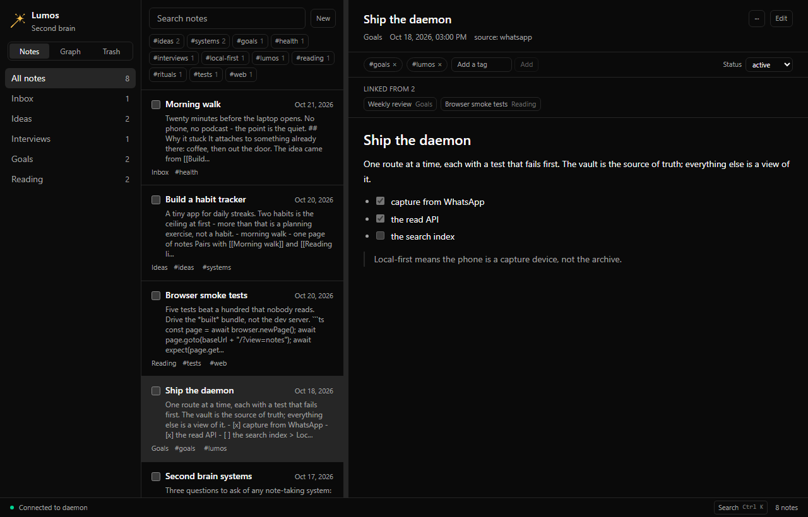

# Lumos, start to finish

A walkthrough you can follow yourself or hand to someone else: from a fresh clone to a note that was
typed on a phone and is now a file you can open in Obsidian. It takes about ten minutes, not counting
waiting for installs.

Every command here is one the repository actually has. If something disagrees with the code, the code
wins - this file is not built or tested by CI.

## What this thing is

Lumos is a "second brain" that lives on your own disk. You message a WhatsApp number, the message
becomes a Markdown file with frontmatter in a folder of your choosing, and a desktop app browses what
you collected - list, note, tags, links, a graph of how notes reference each other.

Nothing leaves the machine except what WhatsApp itself sends. There is no server, no account, no
sync. The vault is ordinary files: `cat` them, grep them, open them in Obsidian.

Two halves:

| Half | What it does | How it starts |
|---|---|---|
| **daemon** | Holds the WhatsApp link, parses messages, writes files, serves a small HTTP API on `127.0.0.1:3001` | `pnpm --filter daemon dev` |
| **desktop** | The app: sidebar, list, reader, editor, search palette, graph, trash | `pnpm --filter desktop dev` (browser at :1420) or `pnpm --filter desktop tauri dev` (the real window) |

The app needs the daemon. The daemon does not need the app - it can run headless and you can talk to
it with `curl`.

## What you need

- **Node 20+** and **pnpm** (`npm i -g pnpm`). This is a pnpm workspace; npm and yarn are not used.
- **A spare phone number with WhatsApp.** Do not use your main number. The bridge is an unofficial
  WhatsApp client, and an account can be banned for it - that is the reason for the spare SIM.
- *Optional:* **Ollama** with a model pulled, for the `/plan` command.
- *Optional:* **Rust + Tauri prerequisites**, only for the real desktop window. The web UI needs none.

## Step 1 - install

```bash
git clone https://github.com/Muhammad-waqar-uit/Lumos.git
cd Lumos
pnpm install
```

Check the workspace is healthy before touching anything:

```bash
pnpm validate
```

That runs lint, format check, typecheck, every test suite and a production build. It is the same gate
the git hooks and CI run, so if it is green you are starting from a working tree.

## Step 2 - tell the daemon who you are

The daemon refuses every sender until you name your own number in an allowlist. Country code, no `+`,
no spaces:

```bash
cd apps/daemon
ALLOWED_NUMBERS=15550100000 pnpm dev
```

An empty allowlist blocks everything, deliberately. The vault path defaults to `../../vault` (the
repo's own `vault/` directory, which is git-ignored), and can be pointed anywhere:

```bash
VAULT_PATH=~/Documents/SecondBrain ALLOWED_NUMBERS=15550100000 pnpm dev
```

For something you keep, put the same settings in a file instead of retyping them. `apps/daemon/lumos.config.json`:

```json
{
  "vault": "../../vault",
  "port": 3001,
  "allowedNumbers": ["15550100000"],
  "whatsapp": true,
  "ollamaUrl": "http://127.0.0.1:11434",
  "ollamaModel": "llama3.2:3b"
}
```

The environment overrides the file, so a one-off `VAULT_PATH=... pnpm dev` still works. A bad setting
stops the daemon with one sentence that names it - never a stack trace.

Now the daemon is up. It prints a QR code in the terminal, which means it is waiting for a phone.

## Step 3 - pair the phone

Three ways, all the same code:

1. **From the app** (the one to show someone): start the desktop, click the chip at the right of the
   status bar - it reads **Pair WhatsApp** - and the panel draws the code. Phone: **WhatsApp →
   Settings → Linked devices → Link a device**, scan. The chip turns to **WhatsApp linked** and the
   panel adds `last message …` once something has been captured.
2. **From the terminal**, on the QR the daemon printed.
3. **From a browser tab**, `http://127.0.0.1:3001/qrcode`.

The session is saved in `apps/daemon/auth_info/`. It is git-ignored; treat it like a password. You
scan once. Delete the folder to force a fresh pairing.

## Step 4 - send the first message

From your own number, to the Lumos number:

```
/idea Build a habit tracker for two habits
```

The phone gets a reply naming the file, and this exists:

```
vault/Ideas/2026-10-26-build-a-habit-tracker-for-two-habits.md
```

Open it in any editor. It is frontmatter plus the message:

```markdown
---
source: whatsapp
created: 2026-10-26T09:14:02.000Z
tags: []
status: new
---

# Build a habit tracker for two habits

Build a habit tracker for two habits
```

Things to try next, in this order - each one shows a different part of the system:

| Send this | What it proves |
|---|---|
| `Buy oat milk` | Plain text lands in `Inbox` |
| `/goal ship the walkthrough by Friday` | Commands pick the folder |
| `/goal ship the walkthrough #launch` | `#hashtags` become frontmatter tags |
| `/newfolder Movies` | A folder is made; the reply names the command it just earned |
| `/movies https://example.com/trailer` | Any folder answers to its own name; the URL goes into the note |
| `/` on its own | The menu, built from the folders on disk |
| `/find habit` | Search across titles, tags and bodies |
| `/plan today` | Five points from the 20 newest notes, through local Ollama |

## Step 5 - open the app

```bash
# in a second terminal, from the repo root
pnpm --filter desktop dev        # http://localhost:1420
```

Or the real window, once Rust and the Tauri prerequisites are installed:

```bash
pnpm --filter desktop tauri dev
```

The app reads the daemon at `http://127.0.0.1:3001`. Point it elsewhere with
`VITE_DAEMON_URL=http://127.0.0.1:3101 pnpm --filter desktop dev`.

**With the daemon stopped it still renders** - it falls back to a demo vault so every panel can be
looked at. The status bar says *Daemon offline - showing demo notes* when it does.



## Step 6 - the tour, in the order it matters

**Find.** `Cmd/Ctrl+K` opens the palette: it ranks titles, tags and previews locally, and asks the
daemon for body matches (those rows say *in the body*). Arrow keys, `Enter`, `Esc`. With nothing
typed it lists what you opened this session - and, under that, six commands: **New note**, **New
folder**, **Open the graph**, **Open the stats**, **Open the trash** and **Open the profile**.

**Write, without leaving the keyboard.** `Cmd/Ctrl+K`, type `new folder`, `Enter`, type `Clients`,
`Enter` - the folder exists, the sidebar shows it, and the list is already looking at it. The same
palette writes a note: **New note** opens the composer in the folder you were in.

**Read.** The viewer renders Markdown, highlights fenced code that names a language, plays a YouTube
or Vimeo link in place, and lists **backlinks** - the notes that link here with `[[like this]]`.

**Edit.** **Edit** turns the body into a textarea with a live preview; `Cmd/Ctrl+S` saves, `Esc`
cancels. Only the body is written - the frontmatter block survives character for character, which is
why tags and status have their own controls in the strip under the header.

**File it.** The **...** button in the note header holds **Rename** (the filename and the first
heading move together, and links elsewhere follow), **Move** (folder only), and **Delete** (moves the
file to the vault's `.trash`, with **Undo** in the status bar). `j` / `k` walk the list.

**Organize in bulk.** Tick the checkboxes: a bar appears with move, add-tag, archive and clear. Each
note is settled on its own, so one refusal does not abandon the rest.

**Folders are the vault's own directories.** The sidebar offers **+ New folder**, and **Rename** /
**Delete** on the folder you are looking at. Removing a folder moves its notes to `Inbox` and then
drops the directory - it never takes a note with it. Files that are not notes are left where they
are, and the folder is kept.

**Look at the shape of it.** **Graph** draws notes as nodes sized by how many notes link to them, one
hue per folder, tag nodes around them. Click a note to open it; click a tag for **Show notes**.

**Watch a capture arrive.** Message the Lumos number without touching the app: within about fifteen
seconds the list gains the note and the status bar says `New note from WhatsApp: "…"` with **Open**.
The app learns it from the link's own poll rather than from watching the folder, which is why a note
written by another program still needs a reload. The chip at the right of the status bar is the
WhatsApp link, with its own dot
and word. Click it: the state in a sentence, when it began, when a message was last answered, the
pairing code if a phone still needs to scan one, and one button. **Disconnect** stops the daemon
answering messages and keeps the phone linked, so **Connect** needs no code. Unlinking stays on the
phone.

| Key | Does |
|---|---|
| `Cmd/Ctrl+K` | Search palette and commands |
| `↑` `↓` `Enter` `Esc` | Move through the palette, open, close |
| `j` / `k` | Down / up the note list |
| `Cmd/Ctrl+S` | Save the note being edited |
| `Cmd/Ctrl+Enter` | File the note being composed |

## Step 7 - talk to the daemon without the app

Everything the app does is one HTTP route, so it is all scriptable. These are copy-pasteable.

```bash
# file a note exactly as a WhatsApp message would (no allowlist involved)
curl -s -X POST http://127.0.0.1:3001/message \
  -H 'content-type: application/json' \
  -d '{"text":"/idea try the API directly"}'

# what the vault holds
curl -s http://127.0.0.1:3001/notes

# search titles, tags and bodies
curl -s 'http://127.0.0.1:3001/notes/search?q=habit'

# folders with counts
curl -s http://127.0.0.1:3001/folders

# make one, then file into it
curl -s -X POST http://127.0.0.1:3001/folders \
  -H 'content-type: application/json' -d '{"name":"Clients"}'
curl -s -X POST http://127.0.0.1:3001/notes \
  -H 'content-type: application/json' -d '{"folder":"Clients","text":"Kickoff notes"}'

# the capture link
curl -s http://127.0.0.1:3001/whatsapp
```

A note created through `POST /notes` is stamped `source: desktop`, so a note never lies about where
it came from. The full route list is in [docs/daemon.md](docs/daemon.md).

## Step 8 - hand the vault to Claude Code

The vault is a folder of Markdown, so a coding agent can use it directly. An MCP server puts twelve
tools over it - list, search, read, create, edit, rename, move, delete, restore - and the client
starts it over stdio: no port, no token, nothing hosted.

```bash
claude mcp add --scope user lumos -- pnpm --dir "$PWD/apps/mcp" start
claude mcp list
```

In a session, `/mcp` lists the tools. Then ask for something you would otherwise search by hand:
*find the notes about the habit tracker and file the newest one under Goals.*

- With the vault somewhere other than this repo, add `--env LUMOS_VAULT=/path/to/notes --transport stdio`
  before the server name (the second flag is there because a name straight after `--env` is read as
  another `KEY=value` pair).
- A note the agent writes is an ordinary note, stamped `source: mcp` in its frontmatter.
- A delete goes to the vault's trash, so it is recoverable; renaming a folder or emptying the trash
  stays a decision you make in the app.
- [docs/mcp.md](docs/mcp.md) has the tool table, the Claude Desktop config and the trade-offs.

## Step 9 - when it misbehaves

| What you see | What it means |
|---|---|
| *Daemon offline - showing demo notes* | The app could not reach `:3001`. Start the daemon, or carry on looking around |
| The daemon refuses to start, one sentence naming a setting | That setting is bad - the sentence says which and why. Fix it, no stack read needed |
| A message from your phone is ignored, log says *not in the allowlist* | `ALLOWED_NUMBERS` has the number in another shape. Digits only, country code first |
| The chip says `WhatsApp off` | Started with `LUMOS_DISABLE_WHATSAPP=1` or `whatsapp: false`. The app cannot switch it on for a run that was started without it |
| The chip says `WhatsApp disconnected` | The link is down but the phone is still paired. Open the panel, press **Connect** - no code needed |
| The chip says `WhatsApp unlinked` | The device was logged out on the phone. Scan a new code |
| A note row says *! frontmatter* | The YAML block does not parse. The note is still readable; the viewer lists what is wrong |
| `400 unknown folder` | A route was asked to file into a folder that is not there. Make it first |
| `409` on a rename | Another note already holds that name. Nothing was replaced |

Nothing in the daemon logs a message body, a note's content, a token or the vault path - by design,
so logs are safe to paste when asking for help.

## Step 10 - what is not built yet

Honest list, so nobody is surprised mid-demo:

- **One vault, one machine.** No sync, no backup, no export. The vault is files; back it up like
  files.
- **No encryption at rest.** Anything with access to the directory can read every note.
- **Messages sent while the daemon is down are lost.** The socket reconnects and backs off, but there
  is no queue and no replay.
- **Unlinking is the phone's job.** Nothing here removes the device from the account; the app only
  reports that it happened.
- **The Tauri window is not covered by CI.** The web UI is. The packaged app is a manual check.
- **A live WhatsApp session is the one path with no automated test.** The parser, the filing, the
  routes and the state machine all have tests; a real linked device does not, and cannot in CI.
- **The MCP server has not been signed into a real client by a test.** The protocol is covered over
  an in-memory transport and the stdio entry point was driven by hand, but an agent choosing the
  tools on its own is a check only a person at a keyboard can make.
- **Nothing notifies an open app when an agent writes.** A note written over MCP shows up on the
  app's next read, not immediately - the live notice follows the WhatsApp link, not the disk.

## A ten-minute demo script

For showing someone, start here and stop at step 9:

1. Terminal one: `cd apps/daemon && ALLOWED_NUMBERS=<your number> pnpm dev`. Say: this is the half
   that owns WhatsApp; it is a local process, nothing is hosted.
2. Terminal two: `pnpm --filter desktop dev`, open `http://localhost:1420`.
3. Point at the status bar: the left dot is the daemon, the chip is the phone. Click the chip, show
   the code, or show `WhatsApp linked` if it already is.
4. On the phone: send `/idea plan the week`. The phone gets a reply, and within about fifteen seconds
   the list gains the note on its own - the status bar names it with an **Open** button. That wait is
   the only part of the demo worth narrating: it is one poll of the link, not a push.
5. Open the note. Show the frontmatter under the header: tags, status, source, date.
6. `Cmd/Ctrl+K`, type a word that is only inside a body - the row says *in the body*. Open it.
7. Same palette: `new folder` → a name → `Enter`. The sidebar grows. Say: those are directories, not
   rows in a database.
8. **Graph**. Say: every `[[link]]` and every shared tag, drawn from the files themselves.
9. Open the note folder in Finder/Explorer or in Obsidian. This is the same content, no import step.
10. Stop.

Then the follow-up sentence that lands: *the whole thing is Markdown on this disk - delete the app
and the notes are still yours.*
